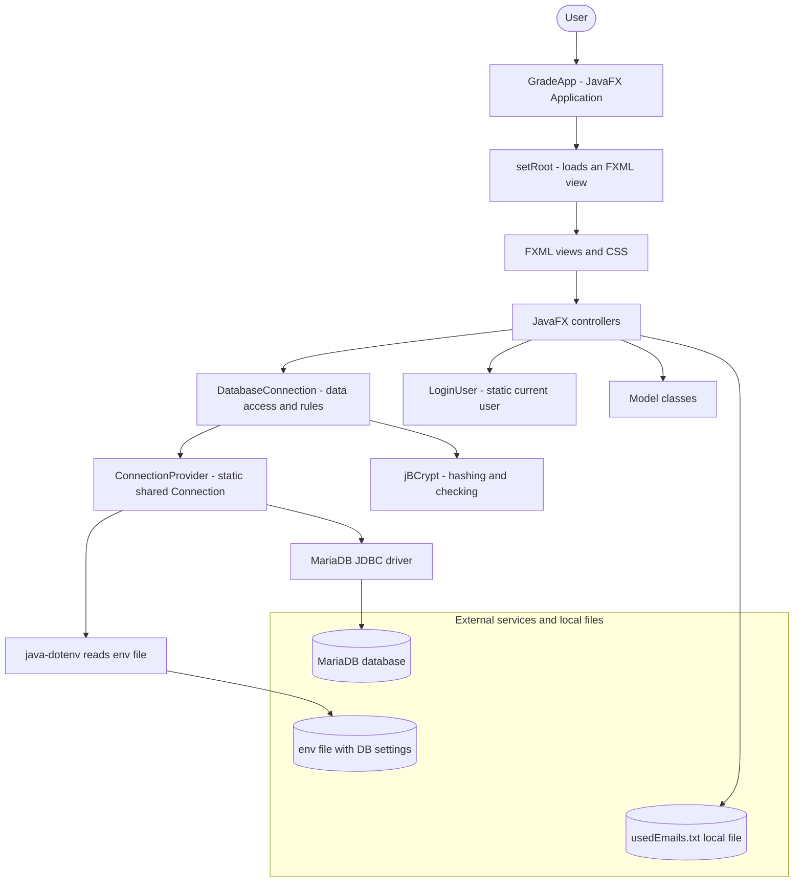
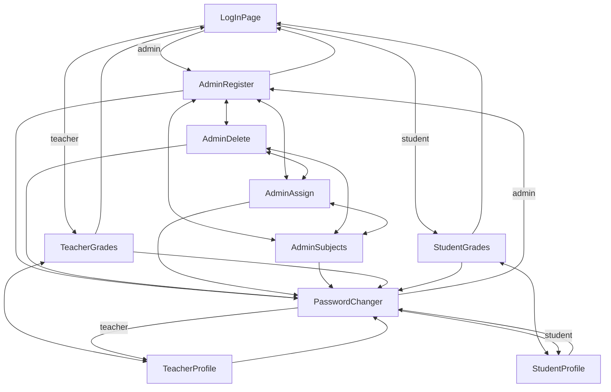
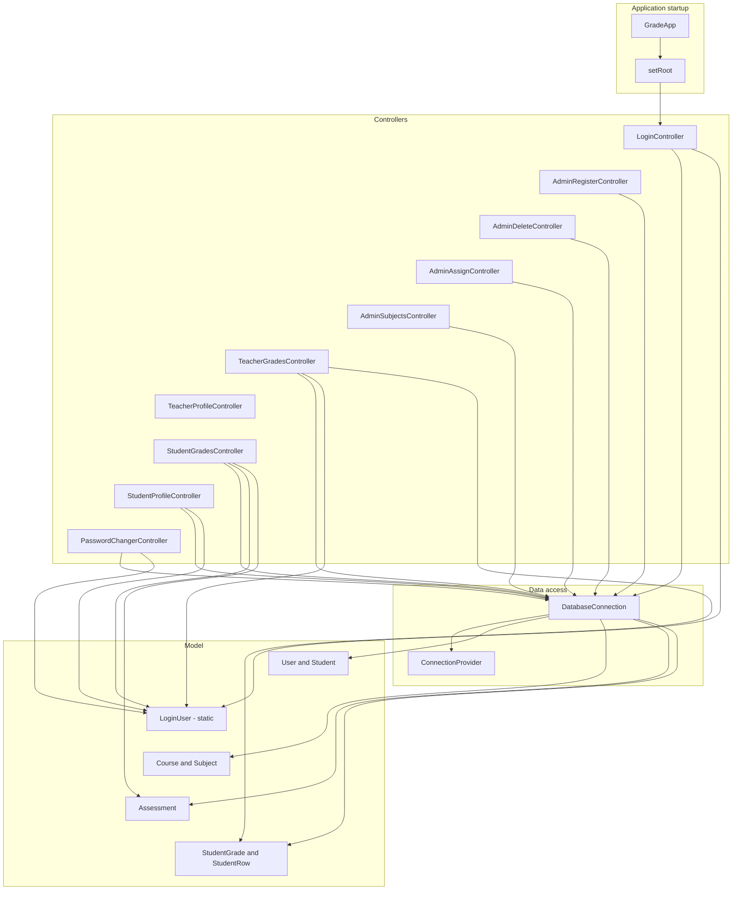
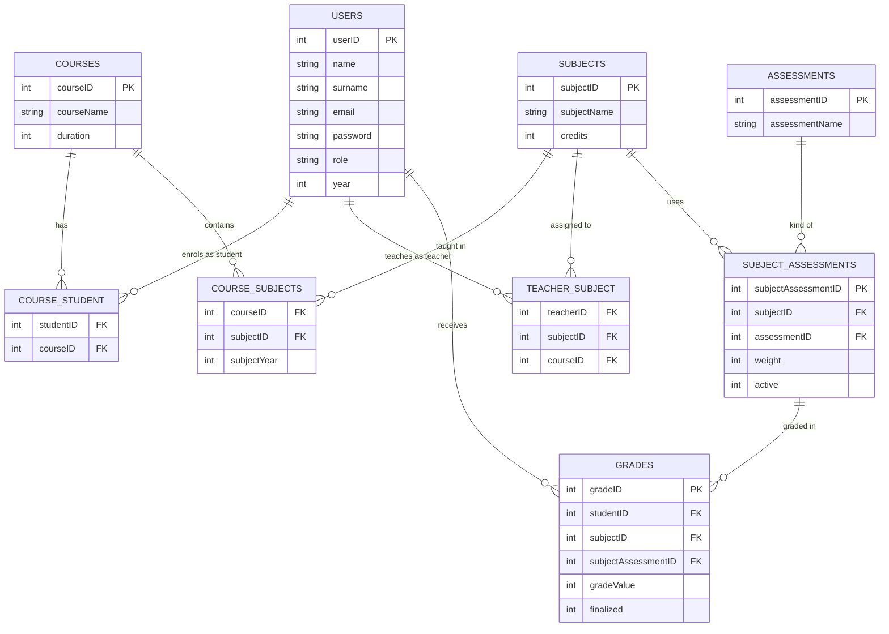
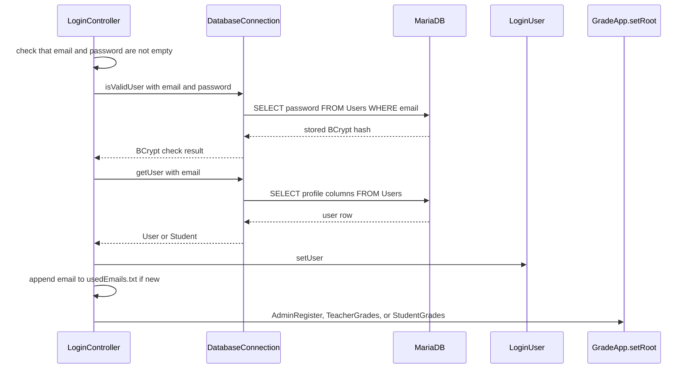
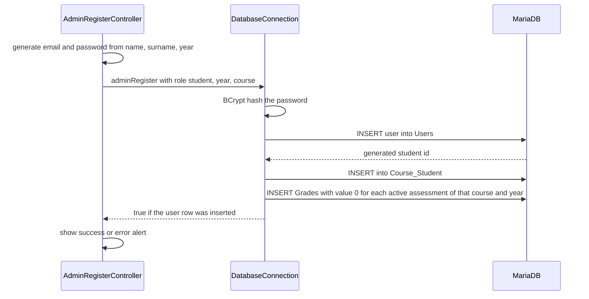
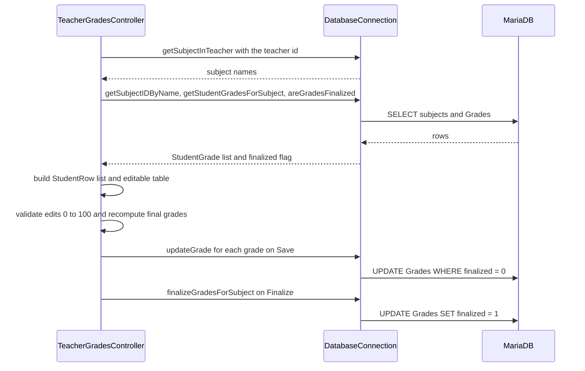
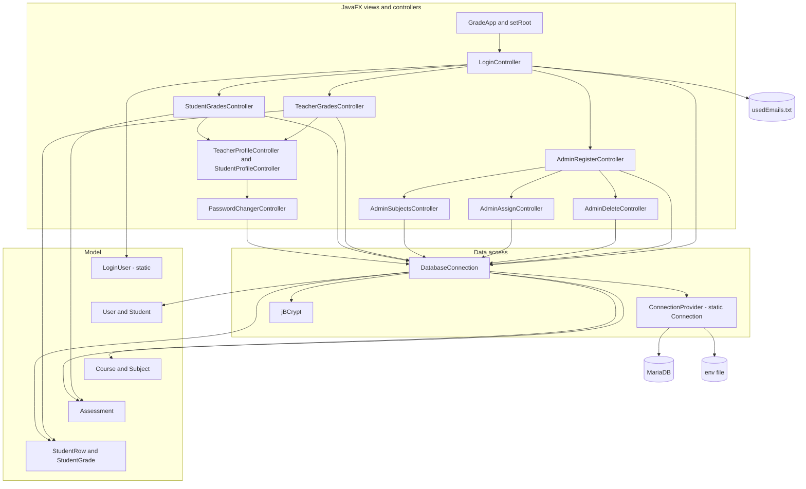

# UniTrack — Desktop Grade Management Application

UniTrack (the project is named `GradeApp` in the repository) is a desktop application for managing university courses, subjects, and student grades. It is a single JavaFX program that talks directly to a MariaDB database over JDBC. There is no separate server: every screen is an FXML view with a controller, and all database access goes through one data-access class.

The application serves three roles:

- **Admin** — registers students, teachers, and other admins; deletes users; assigns subjects to teachers; and configures which assessments (midterm, final, quiz, project, homework) each subject uses and how much each one weighs.
- **Teacher** — selects one of the subjects assigned to them, enters integer grades for every enrolled student, saves them, and finalizes the grades for the subject.
- **Student** — sees the subjects of their course up to their current year, the grade for each assessment, the weighted final grade, and a letter grade.

This README documents the repository as it exists in source. Exact behavior is enforced by the implementation; where configuration is environment-specific, examples use placeholders rather than embedding credentials. The data-access reference is based on the methods and SQL statements in this repository. It was written by reading the source, not by running the application, so it is not a substitute for tests against a running instance. **The repository does not include a database schema script**; the schema described in [Persistence model](#persistence-model) is inferred from the SQL in the code. Places where the source behaves differently from what a reader might expect are called out in [Known limitations and behaviours to verify](#known-limitations-and-behaviours-to-verify).

---

## Contents

1. [Features](#features)
2. [Architecture](#architecture)
3. [Repository layout](#repository-layout)
4. [Prerequisites](#prerequisites)
5. [Initial setup](#initial-setup)
6. [Configuration reference](#configuration-reference)
7. [Run and build](#run-and-build)
8. [Quick start for testers](#quick-start-for-testers)
9. [Screens and navigation](#screens-and-navigation)
10. [Application internals](#application-internals)
11. [Data-access reference](#data-access-reference)
12. [Persistence model](#persistence-model)
13. [Business rules](#business-rules)
14. [End-to-end flows](#end-to-end-flows)
15. [Known limitations and behaviours to verify](#known-limitations-and-behaviours-to-verify)
16. [Testing notes](#testing-notes)
17. [Troubleshooting](#troubleshooting)
18. [Security and deployment notes](#security-and-deployment-notes)
19. [Combined engineering diagram](#combined-engineering-diagram)

---

## Viewing the diagrams

The Mermaid source is kept in this README so diagrams remain editable as text and render automatically on GitHub.

---

## Features

### Accounts and security
- Email and password login. Passwords are stored as BCrypt hashes (`jbcrypt`).
- After login, the user's role decides the first screen: admin, teacher, or student.
- Change-password screen available to every role. It verifies the old password before storing a new hash.
- Logout with a confirmation dialog from every screen.
- Email autocomplete on the login form, based on a local text file of previously used emails.

### Admin features
- **Register users** (admin, teacher, student). The application generates an email and password from the name and surname.
  - A student is placed in a course and a year. The system automatically creates a zero-valued grade row for every active assessment of that course's subjects for that year.
  - A teacher is placed on a course and one subject.
- **Delete users** by searching for a name and surname or by selecting a row in the user table.
- **Assign subjects to teachers** — add or remove a subject for a teacher.
- **Configure subject assessments** — enable or disable Midterm Exam, Final Exam, Quiz, Project, and Homework per subject and set an integer weight for each. The screen displays the running total and the remainder to 100.

### Teacher features
- Pick a subject from the subjects assigned to the logged-in teacher.
- A table lists each student with one editable column per active assessment and a computed final grade and letter.
- Edit grades inline. Values must be integers from 0 to 100.
- **Save** writes changed grades; **Finalize** locks all grades of the subject.
- Profile screen and change-password screen.

### Student features
- A card per subject for the student's course up to the student's current year.
- For each subject: each active assessment with its weight and grade out of 100, the weighted final grade with two decimals, and a letter grade, colour-coded.
- Profile screen showing the student's course, and change-password screen.

---

## Architecture

### System-level architecture



### Runtime boundaries

| Component | Responsibility | Main integration boundary |
|---|---|---|
| JavaFX application | Windows, FXML views, controllers, role navigation, local state | Local process, local file `src/main/usedEmails.txt` |
| `DatabaseConnection` | Every SQL statement, password hashing, and several business rules | JDBC connection to MariaDB |
| MariaDB | Users, courses, subjects, assessments, and grades | Configured by `DB_URL`, `DB_USER`, `DB_PASS` |

There is no network API between the screens and the database. Each controller creates a `new DatabaseConnection()` when it needs data, and all instances share one JDBC `Connection` held by `ConnectionProvider`.

### Typical user-action lifecycle

1. The user clicks a control in an FXML view. JavaFX calls the matching `@FXML` handler on the controller.
2. The controller reads fields, applies simple validation (empty fields, numeric range), and creates `DatabaseConnection`.
3. `DatabaseConnection` runs a `PreparedStatement` on the shared connection and maps rows to model objects, a `List`, a `Map`, or a boolean.
4. The controller updates the screen directly, shows an `Alert`, or calls `GradeApp.setRoot("<View>")` to switch the scene's root to another FXML view.
5. Navigation never opens new windows; one `Scene` is reused and the stage is resized to fit the new view.

---

## Repository layout

```text
GradeApp/
├── pom.xml                              Maven build: JavaFX, ControlsFX, MariaDB, dotenv, jBCrypt, JUnit
├── mvnw, mvnw.cmd, .mvn/wrapper/        Maven wrapper
├── .env                                 Local DB settings (not committed; see .gitignore)
├── .gitignore
└── src/main/
    ├── usedEmails.txt                   Local email autocomplete list, written at login
    ├── java/
    │   ├── module-info.java             Module com.gradeapp.grade_app
    │   └── com/grade_app/
    │       ├── GradeApp.java            Application entry point, setRoot navigation helper
    │       ├── controllers/             One controller per screen (10 classes)
    │       ├── model/                   Data holders and the grade calculation (8 classes)
    │       └── services/
    │           ├── ConnectionProvider.java   Shared JDBC connection built from env settings
    │           └── DatabaseConnection.java   All SQL and persistence-related rules
    └── resources/
        ├── logo.png, student.png, teacher.png   Images used by the views
        └── com/
            ├── ui/                      FXML views (10 files)
            └── css/                     Stylesheets (9 files)
```

> `target/`, `.idea/`, and `.env` are build or developer artifacts that should not be committed. The repository archive supplied for documentation includes IDE metadata; the layout above describes the source structure rather than every archived file. `usedEmails.txt` is a runtime file that stores real email addresses; see [Security and deployment notes](#security-and-deployment-notes).

---

## Prerequisites

Install the following before building from source:

| Dependency | Purpose | Check command |
|---|---|---|
| JDK 25 | The POM sets compiler `source` and `target` to 25 | `java -version` |
| Maven 3.9+ (or the included wrapper) | Build and run | `mvn -version` or `./mvnw -version` |
| MariaDB (or a compatible MySQL-family server) | The application database | `mariadb --version` |
| Git | Clone and update the repository | `git --version` |
| A desktop environment | JavaFX needs a display | n/a |

Libraries downloaded by Maven: JavaFX controls and FXML `21.0.6`, ControlsFX `11.2.1`, MariaDB JDBC `3.0.10`, java-dotenv `5.2.2`, jBCrypt `0.4`, and JUnit Jupiter `5.12.1` (declared for tests; the repository contains no test classes).

The module descriptor also contains `requires kotlin.stdlib;`. The code is pure Java, and no Kotlin library is declared in the POM; if the build complains about that module, remove the line or add the matching dependency.

### Database setup

Create a database and a dedicated local user. Choose your own password; do not reuse one from an old local configuration.

```sql
CREATE DATABASE unitrack CHARACTER SET utf8mb4;
CREATE USER 'unitrack_user'@'localhost' IDENTIFIED BY 'replace_with_a_strong_local_password';
GRANT ALL PRIVILEGES ON unitrack.* TO 'unitrack_user'@'localhost';
FLUSH PRIVILEGES;
```

Then create the tables. **The repository contains no schema script**, so use the schema from your own database or build it from [Persistence model](#persistence-model). Adding a `schema.sql` (tables, constraints, seed course data, and a first admin) to the repository is strongly recommended so anyone can build a working database.

The application never creates or migrates tables. If a table or column is missing, the SQL statement fails, the exception is printed with `printStackTrace()`, and the screen usually shows an empty list or a generic error.

---

## Initial setup

### 1. Obtain the source

```bash
git clone <YOUR_REPOSITORY_URL> GradeApp
cd GradeApp
```

If you already have the repository locally, use `git pull` on the intended branch rather than cloning a second copy. Avoid building from an archive that contains stale `target/` output when troubleshooting compilation.

### 2. Create the `.env` file

Create a file named `.env` in the **project root** (next to `pom.xml`). `ConnectionProvider` uses `Dotenv.load()`, which looks in the current working directory, so start the application from that directory.

```properties
DB_URL=jdbc:mariadb://localhost:3306/unitrack
DB_USER=unitrack_user
DB_PASS=replace_with_your_local_password
```

`.env` is already listed in `.gitignore`. Consider committing a `.env.example` with placeholders so teammates know the keys.

### 3. Create the schema and a first admin

Create the tables ([Database setup](#database-setup)) and insert at least one admin user whose `password` column holds a **BCrypt hash**. The registration screen is only reachable after logging in as an admin, so the first admin must be inserted directly in the database. Generate the hash with any BCrypt tool, or with the same `jbcrypt` library the application uses.

### 4. Build

```bash
./mvnw clean compile
```

### 5. Start the application

```bash
./mvnw javafx:run
```

### 6. Verify

The login window (title "UniTrack", fixed size, not resizable) should open. Sign in as the admin and confirm that the registration screen appears.

---

## Configuration reference

### Environment file (`.env`)

| Variable | Purpose | Required? | Notes |
|---|---|---|---|
| `DB_URL` | JDBC URL | Yes | For example `jdbc:mariadb://localhost:3306/unitrack`. |
| `DB_USER` | Database login | Yes | Prefer a dedicated least-privilege user. |
| `DB_PASS` | Database password | Yes | Never commit the real value. |

If `.env` is missing, `Dotenv.load()` throws and the first screen that touches the database fails.

### Maven properties and plugins

| Setting | Value | Notes |
|---|---|---|
| `maven-compiler-plugin` source/target | `25` | A JDK older than 25 cannot compile the project. |
| `javafx-maven-plugin` | `0.0.8`, main class `com.grade_app.GradeApp` | Used by `javafx:run`. Also configured for a jlink image named `app`. |
| `project.build.sourceEncoding` | `UTF-8` | |
| `junit.version` | `5.12.1` | JUnit Jupiter API and engine, `test` scope. |

### Local files

| File | Purpose |
|---|---|
| `src/main/usedEmails.txt` | One email per line. Read at login-screen start-up to feed the autocomplete menu; a new email is appended after each successful login. The path is relative to the working directory, so the feature only works when the application is started from the project root. |

### Fixed values in code

| Value | Where | Meaning |
|---|---|---|
| Roles `admin`, `teacher`, `student` | `DatabaseConnection`, controllers | Stored in `Users.role`. |
| Assessment names `Midterm Exam`, `Final Exam`, `Quiz`, `Project`, `Homework` | `AdminSubjectsController` | The only assessments the admin screen can configure. |
| Grade range 0–100 | `TeacherGradesController` (`MIN_GRADE`, `MAX_GRADE`) | Enforced in the teacher's grade editor. |

---

## Run and build

```bash
# compile
./mvnw clean compile

# run the application
./mvnw javafx:run

# run unit tests (none exist yet)
./mvnw clean test

# build the jar
./mvnw clean package
```

The `javafx-maven-plugin` is also configured with jlink options (`jlinkImageName` and `jlinkZipName` set to `app`, stripped debug info, no man pages, no header files). A runtime image can be produced with `./mvnw javafx:jlink`; test the packaged image rather than assuming it behaves like `javafx:run`, and remember that the packaged application also needs a reachable database and a `.env` file in its working directory.

### Running tests

The POM declares JUnit Jupiter, but the repository contains **no test sources** and no CI workflow. Dependency presence is not coverage. See [Testing notes](#testing-notes).

---

## Quick start for testers

1. Create the MariaDB database, the tables, and a first admin ([Database setup](#database-setup)).
2. Create `.env` in the project root.
3. Run `./mvnw javafx:run` from the project root.
4. Log in as the admin. The registration screen opens.
5. Register a **teacher**: enter name and surname, choose role `teacher`, choose a course and a subject. The generated email and password appear on the screen; note them.
6. Open **Subjects** and enable assessments with weights for that subject (for example Midterm 40, Final 60).
7. Register a **student**: choose role `student`, a course, and a year. Grade rows for the active assessments of that course's subjects for that year are created with value 0.
8. Log out and log in as the teacher. Pick the subject, enter grades, press Save, then Finalize.
9. Log in as the student and check the subject card, final grade, and letter.

Registration order matters: grade rows for a student are generated from the assessments that are **active at registration time** (see [Known limitations](#known-limitations-and-behaviours-to-verify)).

---

## Screens and navigation

### Screen catalogue

| FXML view | Controller | Role | Purpose |
|---|---|---|---|
| `LogInPage` | `LoginController` | All | Login form with email autocomplete. |
| `AdminRegister` | `AdminRegisterController` | Admin | Register a student, teacher, or admin. |
| `AdminDelete` | `AdminDeleteController` | Admin | Search, select, and delete users. |
| `AdminAssign` | `AdminAssignController` | Admin | Add or remove a subject for a teacher. |
| `AdminSubjects` | `AdminSubjectsController` | Admin | Choose assessments and weights per subject. |
| `TeacherGrades` | `TeacherGradesController` | Teacher | Grade table, save, and finalize. |
| `TeacherProfile` | `TeacherProfileController` | Teacher | Profile and navigation. |
| `StudentGrades` | `StudentGradesController` | Student | Subject cards with grades and final grade. |
| `StudentProfile` | `StudentProfileController` | Student | Profile, including the student's course. |
| `PasswordChanger` | `PasswordChangerController` | All | Change password. |

### Navigation diagram



Every screen's logout button asks for confirmation and returns to `LogInPage`. Navigation between screens is implemented by `GradeApp.setRoot("<FXML name>")`, which loads `/com/ui/<name>.fxml`, replaces the scene root, and resizes the stage to the new content.

---

# Application internals

## Class catalogue

### Application and controllers

| Class | Responsibility |
|---|---|
| `GradeApp` | JavaFX `Application`. Opens `LogInPage` in a non-resizable window titled "UniTrack" and provides the static `setRoot(String)` navigation helper. |
| `controllers.LoginController` | Validates the form, calls `isValidUser` and `getUser`, stores the user in `LoginUser`, routes by role, and manages the email autocomplete file. |
| `controllers.AdminRegisterController` | Role-dependent registration form (course, subject, year selectors), generates email and password, calls `adminRegister`. |
| `controllers.AdminDeleteController` | Loads all users into a table, searches by name and surname, confirms and deletes. |
| `controllers.AdminAssignController` | Finds a teacher by name and surname, lists subjects they have or lack, and adds or removes one. |
| `controllers.AdminSubjectsController` | Chooses assessments and weights for a subject, shows total and remainder, saves with `addOrUpdateSubjectAssessment` and `setAssessmentActive`. |
| `controllers.TeacherGradesController` | Builds a dynamic table of students and assessments, validates edits, saves grades, finalizes the subject. |
| `controllers.TeacherProfileController` | Teacher profile and navigation. |
| `controllers.StudentGradesController` | Builds a card per subject with weighted final grade and letter. |
| `controllers.StudentProfileController` | Student profile, including `getCoursePerStudent`. |
| `controllers.PasswordChangerController` | Calls `changePassword` for the logged-in user's email and routes back to the role's profile or home screen. |

### Model classes

| Class | Responsibility |
|---|---|
| `User` | Immutable id, name, surname, email, and role. |
| `Student` | `User` plus the student's `year`. |
| `LoginUser` | **Static** holder of the currently logged-in `User`. |
| `Course` | Course id, name, and duration in years; `toString()` returns the name for combo boxes. |
| `Subject` | Subject id, name, and credits; `toString()` returns the name. |
| `Assessment` | A subject assessment: `subjectAssessmentID`, name, weight, and (for a student) grade value. |
| `StudentGrade` | One grade row for the teacher view: student, grade id, assessment, value, and `finalized` flag. |
| `StudentRow` | One table row for the teacher view: student name, a list of `GradeData` records, the weighted `finalGrade`, and the letter grade. |

### Services

| Class | Responsibility |
|---|---|
| `services.ConnectionProvider` | Lazily creates one static JDBC `Connection` from `DB_URL`, `DB_USER`, and `DB_PASS` read by java-dotenv, and returns it to every caller. |
| `services.DatabaseConnection` | All SQL and its direct rules: authentication, user CRUD, registration side effects, teacher-subject assignment, assessment configuration, grade queries, saving and finalizing grades, and password change. |

### Dependency diagram



Invisible `~~~` links only guide layout; they are not runtime dependencies.

---

## Data-access reference

`DatabaseConnection` is the only class that talks to the database. All statements use `PreparedStatement` with bound parameters. Most methods catch `SQLException`, print the stack trace, and return an empty list, `null`, `-1`, `""`, or `false`, so a database failure is usually invisible to the user. Two methods (`getSubjectsForStudent` and `getAssessmentsForStudent`) instead declare `throws SQLException` and do not close their statements.

### Authentication and users

| Method | Input | Returns | Tables | Description |
|---|---|---|---|---|
| `isValidUser` | email, password | `boolean` | `Users` | Fetches the stored hash for the email and checks it with `BCrypt.checkpw`. |
| `getUser` | email | `User` or `Student` or `null` | `Users` | Loads the profile; builds a `Student` (with `year`) when the role is `student`. |
| `getAllUsers` | none | `List<User>` | `Users` | All users, no password. |
| `searchUser` | name, surname | `User` or `null` | `Users` | First user with the exact name and surname. |
| `deleteUser` | name, surname | `boolean` | `Users` | Deletes **every** user with that name and surname; related rows depend on the schema's foreign keys. |
| `changePassword` | email, old password, new password | `boolean` | `Users` | Verifies the old password, then stores the new BCrypt hash. The `UPDATE` statement is executed twice in the code. |
| `adminRegister` | name, surname, email, password, role, year, course, subject | `boolean` | `Users`, `Teacher_Subject`, `Course_Student`, `Grades` | Hashes the password and inserts the user. Teachers get a `Teacher_Subject` row; students get a `Course_Student` row and zero-valued `Grades` rows for active assessments of their course's subjects for the chosen year. |

### Courses, subjects, and assignments

| Method | Input | Returns | Tables | Description |
|---|---|---|---|---|
| `getCourses` | none | `List<Course>` | `Courses` | All courses. |
| `getSubjects` | course id | `List<Subject>` | `Subjects`, `Course_Subjects` | Subjects of a course. |
| `getCoursePerStudent` | user id | `String` | `Courses`, `Course_Student`, `Users` | Name of the student's course, or `""`. |
| `getSubjectNotInTeacher` | teacher id | `List<String>` | `Subjects`, `Teacher_Subject` | Subject names not yet assigned to the teacher. |
| `getSubjectInTeacher` | teacher id | `List<String>` | `Subjects`, `Teacher_Subject` | Subject names assigned to the teacher. |
| `submitAssignedSubject` | teacher id, subject name, `"Add"` or `"Delete"` | `boolean` | `Subjects`, `Course_Subjects`, `Teacher_Subject` | Looks up the subject and its course and inserts or deletes the assignment. |
| `getSubjectIDByName` | subject name | `int` (`-1` if missing) | `Subjects` | Name-to-id lookup. |
| `getSubjectsForStudent` | student id, year | `List<Subject>` | `Subjects`, `Course_Subjects`, `Course_Student` | Subjects of the student's course with `subjectYear <= year`, ordered by year and name. |

### Assessments and grades

| Method | Input | Returns | Tables | Description |
|---|---|---|---|---|
| `getSubjectAssessments` | subject id | `Map<String, Integer>` | `Assessments`, `Subject_Assessments` | Active assessment names and weights for a subject. |
| `setAssessmentActive` | subject id, assessment name, flag | `boolean` | `Subject_Assessments`, `Assessments` | Sets the `active` flag. |
| `addOrUpdateSubjectAssessment` | subject id, assessment name, weight, active | `boolean` | `Assessments`, `Subject_Assessments` | Creates the assessment name if new, then inserts or updates the subject's weight and flag. |
| `getAssessmentWeightsForSubject` | subject id | `List<Assessment>` | `Subject_Assessments`, `Assessments` | Active assessments with weights and a grade value of 0. |
| `getAssessmentsForStudent` | student id, subject id | `List<Assessment>` | `Subject_Assessments`, `Assessments`, `Grades` | Active assessments with the student's grade (default 0). |
| `getStudentGradesForSubject` | subject id | `List<StudentGrade>` | `Users`, `Grades`, `Subject_Assessments`, `Assessments` | One row per student and active assessment, ordered by surname and name. |
| `updateGrade` | grade id, value | `boolean` | `Grades` | Updates the value **only** when `finalized = 0`. |
| `finalizeGradesForSubject` | subject id | `boolean` | `Grades` | Sets `finalized = 1` for all non-finalized grades of the subject. |
| `areGradesFinalized` | subject id | `boolean` | `Grades` | `true` when no non-finalized grade rows remain for the subject. |

---

## Persistence model

The database schema is **inferred from the SQL statements** in `DatabaseConnection`. Column types and constraints are not visible in the source; the "Used as" column states how the Java code treats each column.

| Table | Columns used by the code | Responsibility |
|---|---|---|
| `Users` | `userID` (int, generated), `name`, `surname`, `email`, `password` (BCrypt hash), `role` (`admin`, `teacher`, `student`), `year` (students only) | Every account. Email is used as the login key, so it should be unique. |
| `Courses` | `courseID`, `courseName`, `duration` (int) | Degree programs; `duration` drives the year selector. |
| `Subjects` | `subjectID`, `subjectName`, `credits` (int) | Subjects. Names are used as lookup keys. |
| `Course_Subjects` | `courseID`, `subjectID`, `subjectYear` | Which subject belongs to which course and in which year. |
| `Course_Student` | `studentID`, `courseID` | Student enrolment in a course. |
| `Teacher_Subject` | `teacherID`, `subjectID`, `courseID` | Teacher assignment to a subject within a course. |
| `Assessments` | `assessmentID`, `assessmentName` | Catalogue of assessment kinds (Midterm Exam, Final Exam, Quiz, Project, Homework). |
| `Subject_Assessments` | `subjectAssessmentID`, `subjectID`, `assessmentID`, `weight` (int), `active` (0 or 1) | Which assessments a subject uses and with what weight. |
| `Grades` | `gradeID`, `studentID`, `subjectID`, `subjectAssessmentID`, `gradeValue` (int), `finalized` (0 or 1) | One grade per student per subject assessment. |

### Relationship overview



This ER view is conceptual: exact keys, cardinalities, cascade behaviour, and uniqueness constraints must be read from your real database. In particular, check what happens to `Course_Student`, `Teacher_Subject`, and `Grades` rows when a user is deleted, because `deleteUser` only issues a `DELETE` on `Users`.

---

## Business rules

### Login and routing
- The email and password must both be non-empty; otherwise "Empty fields!" is shown.
- Credentials are checked with BCrypt. On success the user is stored in `LoginUser` and the screen changes to `AdminRegister`, `TeacherGrades`, or `StudentGrades`.
- The email is appended to `usedEmails.txt` if it is not already there.

### Registration
- Generated email: lower-case name + lower-case surname + the last two digits of the current year + `@gmail.com`.
- Generated password: lower-case name + lower-case surname + the same two digits.
- Empty name or surname is rejected with "The name or surname field is empty!".
- Role selector offers `admin`, `student`, and `teacher`; the default is `student`.
- A student needs a course and a year (year choices come from the course's duration). A teacher needs a course and a subject.
- The user row is inserted first. For a student, the application then inserts `Course_Student` and a batch of `Grades` rows with value 0 for each active assessment of the course's subjects in the chosen year.

### Assessments and weights
- Assessment kinds are fixed in the admin screen: Midterm Exam, Final Exam, Quiz, Project, Homework.
- For each checked assessment the admin enters an integer weight; unchecked assessments are marked inactive.
- The screen shows "Total Assigned" and "Remaining" (100 minus the total) as a guide. The controller does not block saving when the total is not 100.

### Grade entry and finalization
- Teachers can edit only subjects assigned to them, and only grade cells of non-finalized subjects.
- Edits must be integers between 0 and 100; anything else shows "Grade must be 0–100" and reverts.
- **Save** writes every grade in the table with `updateGrade`, which only changes rows where `finalized = 0`.
- **Finalize** sets `finalized = 1` for all grades of the subject; the Finalize button and the editable cells are then disabled when the subject is reopened. The application contains no un-finalize operation.

### Final grade and letter

The final grade is a weighted average of the active assessments:

`final = sum(grade x weight) / sum(weight)`, or `0` when the total weight is `0`.

The student screen shows the value with two decimals. The letter grade is chosen from these ranges:

| Final grade | Letter |
|---|---|
| 90 – 100 | AA |
| 85 – 89 | BA |
| 80 – 84 | BB |
| 75 – 79 | CB |
| 70 – 74 | CC |
| 65 – 69 | DC |
| 60 – 64 | DD |
| 50 – 59 | FD |
| below 50 | FF |

The boundaries are written as inclusive integer ranges (for example `<= 89 && >= 85`) but are applied to a `double`; see [Known limitations](#known-limitations-and-behaviours-to-verify).

### Password change
- The old password must be correct. The new password field is a plain text field and has no length or complexity rule.

---

## End-to-end flows

### Login and role routing



### Admin registers a student



### Teacher grades a subject



### Student views grades

1. `StudentGradesController` reads the logged-in user from `LoginUser` and requires it to be a `Student`.
2. It calls `getSubjectsForStudent(studentID, year)` and builds a card per subject.
3. For each subject it calls `getAssessmentsForStudent` and renders each assessment with its weight and grade out of 100.
4. It computes the weighted final grade, formats it with two decimals, derives the letter and colour, and shows the result.

### Admin configures assessments

1. `AdminSubjectsController` loads the subjects of a chosen course.
2. The admin ticks the assessments to use and types an integer weight for each. Total and remainder update as the fields change.
3. On submit, for each ticked assessment `addOrUpdateSubjectAssessment` creates or updates the subject's row with `active = 1`; for each unticked one `setAssessmentActive(..., false)` is called.
4. A success or error alert reports the combined result.

### Change password

1. The user opens `PasswordChanger` from any role's screen.
2. `PasswordChangerController` calls `changePassword(LoginUser email, old, new)`.
3. `DatabaseConnection` verifies the old password, hashes the new one, and updates the row.
4. A success or error dialog is shown, and the user returns to their role's screen.

---

## Known limitations and behaviours to verify

These observations come from reading the source. Each is something a reviewer or tester should confirm by running the application.

| # | Observation | Where to look |
|---|---|---|
| 1 | The letter-grade ranges are integer ranges applied to a `double`. A final grade such as `89.5` or `84.5` satisfies none of the listed ranges, so it falls through to the final `else` branch and is mapped to **FF** while the same screen displays it as a high grade. | `StudentRow.getGradeLetter`, `StudentGradesController.getGradeLetter` |
| 2 | The same letter-grade logic is duplicated in two classes, so a fix must be applied in both. | Same as above |
| 3 | Assessment weights are not required to add up to 100. Final grades are normalised by the sum of weights, so a subject with weights `30 + 30` still produces a value out of 100, which may not be the intended behaviour. | `AdminSubjectsController`, `StudentRow`, `StudentGradesController` |
| 4 | Grade rows are created for a student **at registration time**, only for assessments that are active then. Assessments activated later, or a student promoted to a new year, may have no grade rows unless something else creates them; the student view then shows `0` for missing rows. | `adminRegister`, `getAssessmentsForStudent` |
| 5 | `deleteUser` removes all users with the same name and surname, not one specific user. Identical names (also possible for the generated email) would delete several accounts. | `DatabaseConnection.deleteUser`, `AdminDeleteController` |
| 6 | `searchUser` returns the first match for a name and surname; with duplicate names the wrong person may be found. | `DatabaseConnection.searchUser` |
| 7 | Duplicate email handling relies on the database. A duplicate generated email makes the insert fail and the UI shows a generic error. | `adminRegister`, `AdminRegisterController` |
| 8 | A database error is usually swallowed: the exception is printed to the console and the method returns an empty value. Users may see an empty list rather than an error. | `DatabaseConnection` |
| 9 | `ConnectionProvider` caches a single static `Connection` forever; there is no reconnect if it times out and no connection closing. | `ConnectionProvider` |
| 10 | `changePassword` executes the same `UPDATE` twice and returns the result of the second execution. | `DatabaseConnection.changePassword` |
| 11 | The new-password field in the password screen is a plain `TextField`, so the typed value is visible. | `PasswordChanger.fxml`, `PasswordChangerController` |
| 12 | Teachers are matched to a subject by **name** (`getSubjectIDByName`), so two subjects with the same name in different courses collide. `submitAssignedSubject` also picks the course with a sub-query on `Course_Subjects` by subject id only. | `DatabaseConnection` |
| 13 | `Finalize` always shows "Grades finalized." even when `finalizeGradesForSubject` updated zero rows or failed, because the return value is ignored. | `TeacherGradesController.finalizeGrades` |
| 14 | `AdminDeleteController`, `AdminAssignController`, and others re-create `DatabaseConnection` instances repeatedly; combined with the shared static connection this is a possible source of state and concurrency problems when tests run in parallel. | Controllers |
| 15 | `usedEmails.txt` is stored relative to the working directory and contains real email addresses; it is not listed in `.gitignore`. | `LoginController`, `.gitignore` |
| 16 | `module-info.java` requires `kotlin.stdlib`, which the POM does not provide. | `module-info.java`, `pom.xml` |
| 17 | The `.idea` folder includes IDE data-source metadata, which can contain connection details. It should not be shared. | `.idea/` |

---

## Testing notes

The project has no automated tests today, so everything below is a starting point rather than a description of existing coverage.

### How the code is structured for testing

- `DatabaseConnection` has a constructor with no parameters that calls the static `ConnectionProvider.getConnection()`, so the class **cannot be given a test connection** without refactoring. Options: add a constructor that accepts a `Connection`, or point `.env` at a disposable test database and run integration tests against it.
- The grade calculation and the letter mapping live in `StudentRow` and `StudentGradesController`; the `StudentRow` logic can be unit-tested directly (no JavaFX needed) because it only uses plain Java collections.
- The JavaFX controllers mix input validation, database calls, and UI updates, so unit tests for them need either TestFX (UI-level) or a refactor that extracts the logic.
- JUnit 5 is already declared in the POM. The module descriptor may need `opens` or `--add-opens` flags for tests that touch controllers.
- Passwords are BCrypt-hashed with a random salt, so hashes cannot be compared directly; use `BCrypt.checkpw`.

### Suggested test levels

| Level | Targets |
|---|---|
| Unit | Weighted final grade (including zero weights, one assessment, all zeros, all 100), letter-grade boundaries (`49.99`, `50`, `59.99`, `60`, `89.5`, `90`, `100`), generated email and password format, grade range validation 0–100. |
| Integration (database) | Each `DatabaseConnection` method against a test MariaDB: login, user CRUD, registration side effects (`Course_Student` and `Grades` rows), assignment add/remove, assessment create/update/deactivate, `updateGrade` blocked after finalize, `finalizeGradesForSubject`. |
| Boundary and equivalence | Grade values `-1`, `0`, `1`, `99`, `100`, `101`; empty, very long, and special-character names; weight totals of `0`, `99`, `100`, `101`. |
| UI / system | Login for each role, wrong credentials, empty fields, every admin screen, teacher save and finalize, student view, logout confirmation, window navigation (TestFX or manual scripts). |
| Security | SQL injection attempts in name and email fields (statements are parameterised, so they should be harmless), role isolation (a student cannot reach admin screens through the UI), password change with the wrong old password. |
| Performance | Many students per subject in the teacher table, many subjects on the student screen. |
| Usability and error handling | What the user sees when the database is down or a table is missing. |

### Test data

- Keep a dedicated test database; do not run tests against a database with real grades.
- A minimal fixture is one admin, one course with duration 3, two subjects in different years, one teacher assigned to one subject, two students in different years, and active assessments with weights summing to 100.

---

## Troubleshooting

### The application fails at start-up or on login with a `Dotenv` or `SQLException` error
- Confirm `.env` exists in the working directory and contains `DB_URL`, `DB_USER`, and `DB_PASS`.
- Start the application from the project root.
- Check that MariaDB is running and that the JDBC URL, user, and password are correct.

### Login always fails
- Make sure the `Users.password` value is a valid BCrypt hash (`$2a$...`), not plain text.
- Check the email for case or whitespace differences; the form trims whitespace.

### Registration shows an error or nothing happens
- The generated email may already exist; the database rejects duplicates. Use a different name and surname combination.
- Check the console for the SQL exception text.

### A student sees all grades as `0` or no subjects
- Grade rows are created at registration for active assessments only. Activate the assessments first, then register the student, or create the missing `Grades` rows.
- Subjects appear only when `Course_Subjects.subjectYear` is less than or equal to the student's year and the student has a `Course_Student` row.

### The teacher's subject list is empty
- The subject must be assigned in `Teacher_Subject` (use the Assign screen).

### Grades will not change
- The subject has been finalized; `updateGrade` only updates rows with `finalized = 0`, and there is no un-finalize screen.

### Letter grade looks wrong for a decimal final grade
- See limitation 1: values between the integer boundaries fall through to `FF`.

### Email autocomplete does not appear
- `src/main/usedEmails.txt` is read relative to the working directory. Start from the project root.

### Compilation errors about Java version or `kotlin.stdlib`
- Use JDK 25 (the POM requires `source` and `target` 25).
- If the module system complains about `kotlin.stdlib`, remove that `requires` line or add the dependency.

---

## Security and deployment notes

- **Rotate exposed secrets.** The supplied archive contained a `.env` file and IDE data-source metadata. Revoke or rotate any real database credentials found there, never commit `.env`, and exclude `.idea/` from version control.
- **Do not publish `usedEmails.txt`.** It stores real addresses collected at login; add it to `.gitignore` and ship an empty file or none.
- **Generated passwords are predictable** (name, surname, two-digit year) and are shown on the registration screen. Replace them with random one-time passwords and force a change at first login.
- **Enforce roles at the data layer.** The application hides screens by role, but `DatabaseConnection` has no permission checks. Any code path that reaches it can change any grade or delete any user.
- **Use a least-privilege database account** that cannot alter the schema, and consider separate accounts per role if the architecture changes to a server.
- **A shared direct database connection from a desktop client** means every client machine holds database credentials. For a real deployment, move database access behind a server API.
- **Hash handling is correct in principle** (BCrypt with a per-password salt via `gensalt`); keep it that way, and add minimum length and complexity rules.
- **Mask the new-password field** and add confirmation.
- **Make grade changes auditable.** Record who changed a grade and when, and consider a controlled "reopen grades" process instead of permanent finalization.
- **Add a schema and migration process** (for example Flyway or Liquibase) and commit it with the code.
- **Add automated tests and CI.** See [Testing notes](#testing-notes).

---

## Combined engineering diagram

This combined diagram shows individual controllers, model classes, and data-access methods instead of reducing the system to three boxes. It focuses on the primary execution paths; some leaf helpers are omitted to keep the diagram readable.


